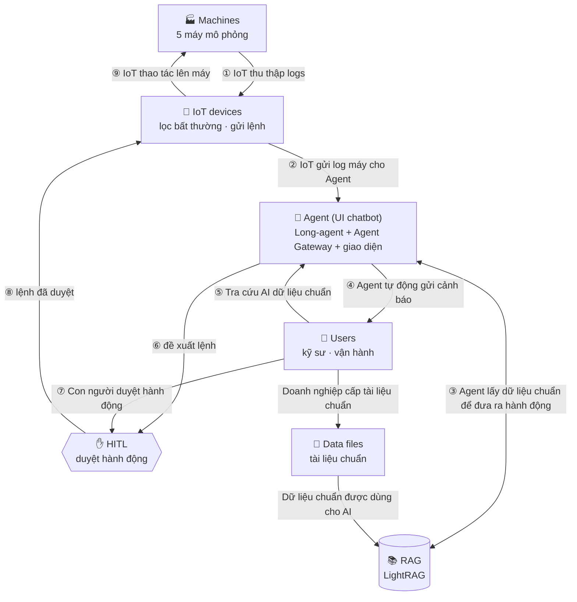

# DENSO A3 – Knowledge Agent

Dự án cho đề A3 – DENSO Factory Hacks 2026. Một trợ lý AI cho nhà xưởng, gồm hai phần dùng chung một giao diện:

- **Chatbot tài liệu kỹ thuật** – đọc tài liệu doanh nghiệp cấp (PDF, bản scan, ảnh chụp, DOCX, XLSX, TXT;
  tiếng Việt, Anh, Nhật), trả lời bằng ngôn ngữ người hỏi, **luôn kèm tài liệu và số trang**, và nói rõ
  khi tài liệu không có câu trả lời.
- **Giám sát nhà xưởng (Long-agent)** – 5 máy mô phỏng gửi số liệu, hệ thống phát hiện bất thường, agent
  tự gửi cảnh báo và đề xuất lệnh sửa; **mọi lệnh chỉ chạy sau khi con người duyệt** (Human-in-the-Loop).
  Lệnh chỉ đi tới máy mô phỏng, không tới PLC thật.

---

## Mục lục

1. [Kiến trúc tổng thể](#1-kiến-trúc-tổng-thể)
2. [Các thành phần](#2-các-thành-phần)
3. [Luồng hoạt động](#3-luồng-hoạt-động)
4. [Cấu trúc thư mục](#4-cấu-trúc-thư-mục)
5. [Chạy nhanh](#5-chạy-nhanh)
6. [An toàn và giới hạn](#6-an-toàn-và-giới-hạn)
7. [Nguồn gốc và giấy phép](#7-nguồn-gốc-và-giấy-phép)

---

## 1. Kiến trúc tổng thể



Hệ thống có hai vòng chạy song song:

| Vòng | Đi qua | Mục đích |
|---|---|---|
| **Vòng tri thức** | Users → Data files → RAG → Agent → Users | Doanh nghiệp nạp tài liệu chuẩn; người dùng hỏi và nhận câu trả lời có trích nguồn |
| **Vòng vận hành** | Machines → IoT → Agent → HITL → IoT → Machines | Phát hiện sự cố, chẩn đoán, đề xuất sửa; con người duyệt rồi lệnh mới tới máy |

---

## 2. Các thành phần

Mỗi khối trong sơ đồ ứng với phần code dưới đây.

| Khối trong sơ đồ | Code | Cổng | Vai trò |
|---|---|---|---|
| **Machines** | `long_agent/machines/` | – | 5 máy mô phỏng (CNC, robot, ép nhựa, AOI, AMR) sinh số liệu mỗi giây theo mô hình vật lý; trạng thái chạy / dừng / khoá an toàn / bảo trì / dừng khẩn cấp; tự khai báo và kiểm tra lệnh |
| **IoT devices** | `long_agent/iot/` | – | `telemetry_receiver` lọc bất thường (ngưỡng + tốc độ biến thiên + cooldown); `event_bus` chuyển sự kiện; `actuator_dispatcher` gửi lệnh xuống máy |
| **Agent – bộ não** | `long_agent/agent/` | 8085 | `brain.py` nhận cảnh báo; `rag_engine.py` tra SOP trong LightRAG và để LLM chọn một lệnh sửa máy khai báo; `procedures.py` lập quy trình dừng – khoá – sửa – khởi động |
| **Agent – Gateway** | `denso/gateway/` | 9700 | Backend của giao diện: hỏi đáp, phân quyền, trích dẫn, upload; dựng sự cố từ cảnh báo của Long-agent; chuyển quyết định duyệt |
| **Agent – UI chatbot** | `lightrag_webui/src/features/agentic/` | 5173 / Vercel | Khung chat, mục **Automated Alerts**, thẻ duyệt lệnh, kho tri thức, nút **Dashboard** |
| **HITL** | `long_agent/iot/action_approval.py`, `procedure_runner.py` | – | Giữ mọi đề xuất ở trạng thái chờ; duyệt sửa → chạy quy trình; xong thì xin duyệt khởi động lại; theo dõi để xác minh; ghi lịch sử |
| **RAG** | `lightrag/` (lõi LightRAG) | 9621 / 9631 | Kho tri thức (`level_1`) và kho tra cứu theo xe (`level_1_lookup`); embedding bge-m3, reranker ngôn ngữ :7998 |
| **Data files** | `denso/pipeline/`, `denso/gateway/jobs.py` | Docling 5001 | Đọc tài liệu (Docling), đọc trang scan bằng mô hình thị giác, làm sạch, gắn số trang + ngôn ngữ, nạp vào RAG |
| **Users** | trình duyệt | – | Hỏi đáp, nhận cảnh báo, duyệt / từ chối lệnh; tester bật lỗi mô phỏng trên bảng Dashboard |

Dịch vụ phụ: proxy LLM `denso/tools/llm_rate_proxy.py` (:8899, giới hạn tốc độ, chèn API key) tới
NVIDIA Nemotron 120B; Ollama :11434 chạy embedding trên máy.

---

## 3. Luồng hoạt động

### 3.1. Nạp tài liệu chuẩn (Data files → RAG)

```
Người dùng upload (Kho tri thức trên giao diện)  ─►  POST /agent/documents  (gateway)
        │  hàng đợi jobs.py, xem tiến độ ở GET /agent/documents/jobs/{id}
        ▼
1. parse      Docling :5001 đọc bố cục, bảng, trang       (TXT đọc thẳng, XLSX mỗi sheet một trang)
2. OCR        trang scan / ảnh chụp → mô hình thị giác     (chỉ tài liệu cấp 1)
3. clean      làm sạch, gắn "--- [Trang N | ngôn ngữ: xx] ---"
4. ingest     chia đoạn, tạo vector, nạp vào LightRAG kho đúng cấp quyền
5. ảnh        đọc chữ trong ảnh của PDF, bổ sung sau      (tài liệu đã hỏi được từ bước 4)
```

### 3.2. Tra cứu tài liệu (Users → Agent → RAG → Users)

```
Câu hỏi  ─►  POST /agent/chat (gateway :9700)
        │  • xác định cấp quyền người hỏi (token, khách = cấp 1)
        │  • nhận diện ngôn ngữ, thêm chỉ dẫn trả lời cùng ngôn ngữ
        ▼
LightRAG :9621 (tri thức) / :9631 (tra cứu theo xe)
        │  tìm đoạn liên quan → reranker ưu tiên cùng ngôn ngữ → LLM soạn câu trả lời
        ▼
Gateway chọn tài liệu + trang để trích; không đủ căn cứ thì nói rõ là tài liệu không có
        ▼
Câu trả lời kèm trích dẫn (tên tài liệu, trang) – bấm để xem trang gốc
```

### 3.3. Giám sát, chẩn đoán và cảnh báo tự động (Machines → IoT → Agent ↔ RAG → Users)

```
Máy mô phỏng sinh số liệu mỗi giây  (tester bật lỗi trên bảng Dashboard để tạo sự cố)
        │  số đo đi theo cơ cấu chấp hành: triệu chứng của lỗi chỉ xuất hiện khi bộ phận đó hoạt động
        ▼
IoT: TelemetryReceiver so với ngưỡng (machines/specifications.py) + tốc độ biến thiên
        │  đang chạy ổn định → kiểm tra đủ; đang dừng/khởi động → chỉ ngưỡng trần; khoá an toàn → không cảnh báo
        ▼
Agent (brain.py → rag_engine.py)
        │  • bỏ qua máy đang có quy trình hoặc vé chờ duyệt; mỗi máy chỉ chẩn đoán lại khi có chỉ số lệch MỚI
        │  • tra tài liệu SOP trong LightRAG theo triệu chứng (agent/retriever.py)
        │  • LLM chọn ĐÚNG MỘT lệnh sửa trong danh sách máy khai báo (+ lệnh tạm thời nếu cần), kèm nguồn
        │  • tên lệnh được chuẩn hoá (hoa/thường, dấu, khoảng trắng, tên gọi khác); sai thì hỏi lại 1 lần,
        │    vẫn sai thì không đề xuất – văn bản tự do không bao giờ thành lệnh
        ▼
agent/procedures.py lập quy trình từ đồ thị trạng thái của máy:  SAFE_STOP → LOCKOUT → <lệnh sửa> → UNLOCK
        ▼
Gateway dựng một sự cố cho mỗi máy; giao diện hỏi GET /agent/incidents mỗi 4 giây → hội thoại trong
"Automated Alerts": cảnh báo, chẩn đoán có trích nguồn, thẻ quy trình chờ duyệt, từng bước đã làm.
Người dùng hỏi tiếp ngay trong hội thoại – câu hỏi gửi kèm bối cảnh sự cố và trả lời theo tài liệu (3.2).
```

### 3.4. Duyệt và thực hiện sửa chữa (Agent → HITL → IoT → Machines), hai lần duyệt

```
Vé 1 "Sửa: <lệnh sửa>" – thẻ liệt kê các bước          [Duyệt] / [Từ chối]   (gateway kiểm quyền duyệt)
        │  duyệt → ProcedureRunner chạy từng bước:
        │    SAFE_STOP  máy dừng: tốc độ, tải, dòng về 0, nhiệt nguội dần
        │    LOCKOUT    chờ bộ phận chuyển động đứng yên rồi mới khoá an toàn
        │    <sửa>      MAINTENANCE trong thời gian sửa; chỉ gỡ đúng lỗi của bộ phận đó, KHÔNG đổi số đo
        │    UNLOCK     máy về STOPPED
        ▼
Vé 2 "Khởi động lại" – kỹ sư kiểm tra máy rồi duyệt     → START (liên động: quá nhiệt, pin cạn… thì chờ)
        ▼
Máy chạy lại, số đo hồi phục dần theo vật lý → theo dõi 2 phút
        ├─ không cảnh báo → "đã xác minh"
        └─ cảnh báo quay lại → "sửa chưa đúng"; agent chẩn đoán lại, không đề xuất lại lệnh đã thất bại
Từng quyết định, bước, kết quả hiện trong hội thoại sự cố. Vé không ai duyệt hết hạn sau 30 phút (ghi lại).
```

---

## 4. Cấu trúc thư mục

```
LightRAG/
├── README.md                    tài liệu này
├── .env                         (gitignored) cấu hình + API key, ghép từ env.example và denso/env.denso
│
├── denso/                       ★ phần chính của dự án – hướng dẫn chi tiết ở denso/README.md
│   ├── scripts/serve_chat.ps1   bật toàn bộ backend (-WithUI giao diện, -WithIoT Long-agent, -Tunnel demo)
│   ├── start.ps1                bật Docker Desktop + Docling
│   ├── pipeline/                xử lý tài liệu: Docling → OCR → làm sạch → nạp vào LightRAG
│   ├── gateway/                 Agent Gateway :9700 – backend của giao diện
│   │   ├── app.py               API, phân quyền, trích dẫn, upload/xoá tài liệu, relay dashboard
│   │   ├── long_agent.py        dựng sự cố + thẻ duyệt HITL từ cảnh báo của Long-agent
│   │   └── jobs.py, language.py, lookup.py
│   ├── tools/                   proxy giới hạn tốc độ LLM, reranker ưu tiên ngôn ngữ
│   ├── prompts/                 quy tắc trả lời, loại thực thể cho đồ thị
│   ├── tests/                   test gateway và pipeline (pytest)
│   ├── docs/                    đặc tả API gateway (AGENT_GATEWAY_SPEC.md)
│   ├── docling/                 Docling bản CPU (Docker)
│   └── data/ logs/ results/     (gitignored) tài liệu, log, kết quả đo
│
├── long_agent/                  Long-agent – giám sát nhà xưởng mô phỏng (long_agent/README.md)
│   ├── main.py                  ghép 3 tầng + FastAPI :8085
│   ├── machines/                Machines: 5 máy mô phỏng, lệnh khai báo (commands.py), ngưỡng
│   ├── iot/                     IoT devices + HITL: lọc bất thường, duyệt, chạy quy trình, gửi lệnh
│   ├── agent/                   Agent: chẩn đoán (LLM + SOP từ LightRAG), lập quy trình sửa
│   ├── docs/maintenance_sop.md  SOP bảo trì 5 máy – nạp vào kho tri thức cho agent tra
│   ├── dashboard/               bảng tester (bật lỗi mô phỏng), API trạng thái
│   ├── machines_description.md  mô tả máy và lỗi – cũng nạp vào kho tri thức
│   └── tests/
│
├── lightrag_webui/              giao diện web (React + Vite), deploy lên Vercel (vercel.json)
│   ├── agentic.html             trang vào của giao diện DENSO
│   └── src/
│       ├── features/agentic/    ★ UI chatbot: chat, Automated Alerts, thẻ duyệt, kho tri thức
│       │   ├── components/      thanh trên (nút Dashboard), sidebar sự cố, khung chat, thẻ HITL
│       │   ├── stores/          trạng thái hội thoại, duyệt / từ chối qua gateway
│       │   ├── liveIncidents.ts gộp sự cố từ gateway vào sidebar, theo thứ tự thời gian
│       │   └── mock/            dữ liệu mẫu khi chạy không có gateway
│       ├── api/agent.ts         client gọi Agent Gateway
│       └── ...                  phần còn lại là WebUI gốc của LightRAG
│
├── lightrag/                    RAG: lõi LightRAG (HKUDS), dùng nguyên, không sửa
├── tests/                       test của lõi LightRAG
├── docs/                        tài liệu LightRAG gốc (docs/LightRAG-README.md) và thiết kế lõi
├── scripts/                     bộ chạy test, bộ cài đặt môi trường của LightRAG
├── prompts/                     mẫu prompt của LightRAG
├── pyproject.toml, uv.lock      phụ thuộc Python (uv sync)
├── Dockerfile, docker-compose-full.yml, Makefile, env.example   từ LightRAG gốc
│
└── rag_storage/                 (gitignored) kho tri thức: level_1/, level_1_lookup/
```

---

## 5. Chạy nhanh

Chi tiết từng bước (cài đặt, dữ liệu, `.env`, giao diện) ở [denso/README.md](denso/README.md) mục 3.

```powershell
uv sync --extra api
uv pip install --python .venv\Scripts\python.exe -r denso\requirements.txt
powershell -ExecutionPolicy Bypass -File denso\start.ps1 -DoclingOnly                        # Docling, cần cho upload
powershell -ExecutionPolicy Bypass -File denso\scripts\serve_chat.ps1 -WithUI -WithIoT        # backend + giao diện + Long-agent
```

| Địa chỉ | Dùng để |
|---|---|
| http://localhost:5173 | giao diện (chat, Automated Alerts, duyệt lệnh) |
| http://localhost:9700/dashboard/ | bảng tester Long-agent – bật lỗi mô phỏng |
| http://localhost:9700/docs | API của Agent Gateway |

Bản demo trên Vercel: thêm `-Tunnel`, script in ra link `https://light-rag-charlotte-eb9d.vercel.app/?gateway=<tunnel>`.
Máy chạy backend phải luôn bật thì link mới hoạt động.

| Cổng | Dịch vụ |
|---|---|
| 5173 | giao diện dev |
| 9700 | Agent Gateway |
| 9621 / 9631 | LightRAG kho tri thức / kho tra cứu theo xe |
| 8085 | Long-agent |
| 8899 | proxy API LLM |
| 7998 | reranker ngôn ngữ |
| 5001 | Docling |
| 11434 | Ollama (embedding) |

---

## 6. An toàn và giới hạn

- **Human-in-the-Loop bắt buộc** – không lệnh nào của agent tự chạy; chỉ tài khoản có quyền duyệt mới bấm được Duyệt.
- **Chỉ máy mô phỏng** – không kết nối PLC / phần cứng thật. Không dùng làm giao diện điều khiển sản xuất.
- **Phân cấp tài liệu** – mỗi cấp quyền một kho riêng; câu hỏi và đoạn tài liệu **cấp 1** mới được gửi tới API
  LLM bên ngoài, tài liệu cấp 2/3 không rời khỏi máy.
- **API key** chỉ nằm trong `.env` (gitignored), không commit.
- **Long-agent lưu trạng thái trong RAM** – cảnh báo và vé chờ duyệt mất khi tắt; cổng 8085 không có xác thực
  nên chỉ mở trên localhost, truy cập từ ngoài qua gateway.
- **Lệnh do máy khai báo** – mỗi máy tự khai báo lệnh của nó (`long_agent/machines/commands.py`): tham số, trạng thái
  được phép, lỗi mà lệnh sửa. Lệnh sửa chỉ chạy khi máy đã khoá an toàn; không lệnh nào ghi đè số đo.
- **Nút "Reset mô phỏng (tester)"** trên bảng Dashboard xoá lỗi ngay – chỉ để tester dọn máy giữa các kịch bản,
  không phải sửa chữa và không nằm trong luồng của agent.

---

## 7. Nguồn gốc và giấy phép

Lõi RAG là [LightRAG](https://github.com/HKUDS/LightRAG) (HKUDS, giấy phép MIT – xem [LICENSE](LICENSE)).
Nhánh này bỏ các ví dụ, bộ triển khai Kubernetes/Docker không dùng và tài liệu dịch của bản gốc; test và
tài liệu thiết kế của lõi được giữ để vẫn kiểm tra được LightRAG.
